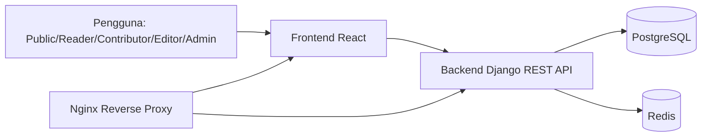
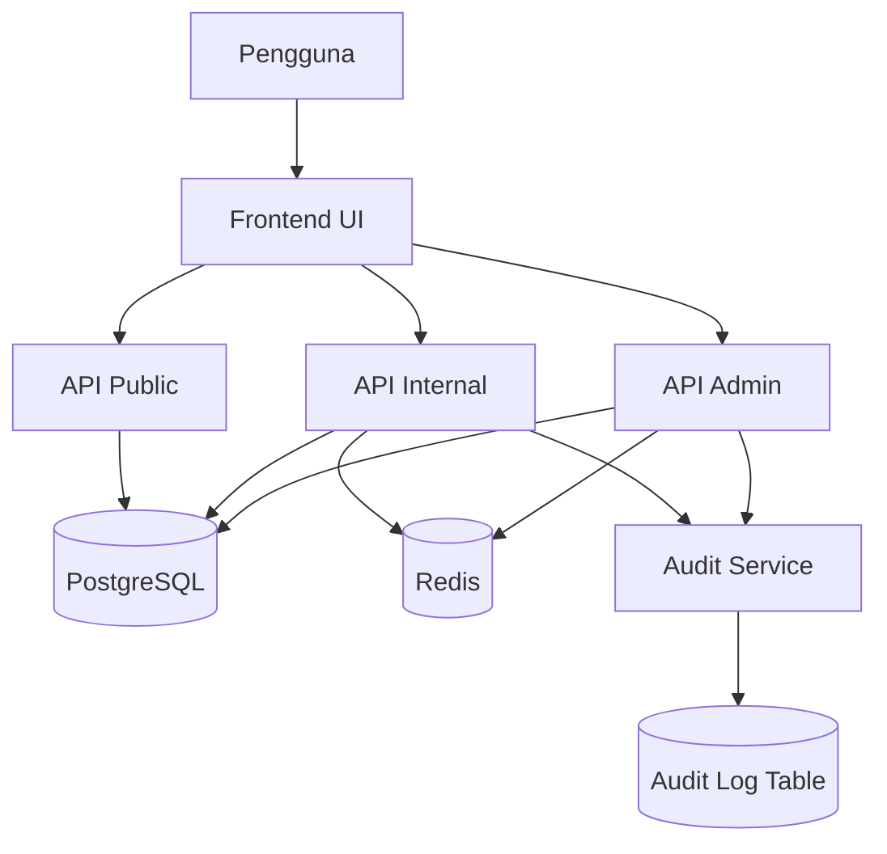
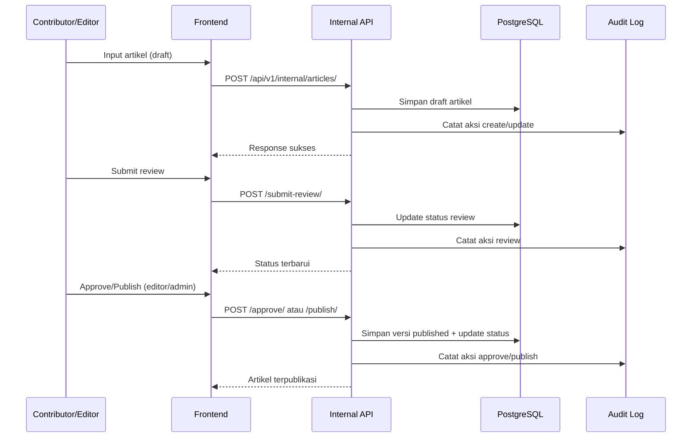
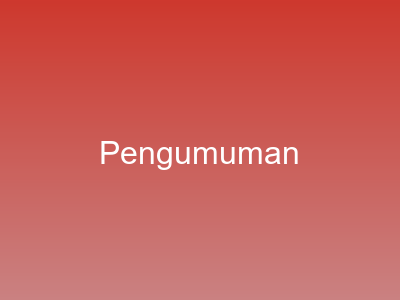

# Laporan Pengembangan Aplikasi KMSetjen DPD RI

Tanggal: 6 April 2026

## A. Pendahuluan

### 1. Latar Belakang
KMSetjen DPD RI dikembangkan sebagai platform Knowledge Management untuk mendukung pengelolaan pengetahuan kelembagaan secara terstruktur, aman, dan mudah diakses. Sistem ini dibangun untuk menjawab kebutuhan:
- Penyimpanan dan publikasi pengetahuan organisasi secara terpusat.
- Tata kelola konten dengan alur kerja editorial (draft, review, approval, publish).
- Pengaturan hak akses berbasis peran (Role-Based Access Control).
- Ketersediaan antarmuka bilingual (Bahasa Indonesia dan English).
- Pencatatan jejak aktivitas (audit trail) untuk akuntabilitas.

Secara teknis, aplikasi menggunakan arsitektur modern berbasis frontend React, backend Django REST Framework, database PostgreSQL, serta dukungan deployment Docker dan Nginx.

### 2. Tujuan Pengembangan
Tujuan pengembangan aplikasi KMSetjen DPD RI adalah:
- Menyediakan sistem manajemen pengetahuan internal dan publik yang terintegrasi.
- Mempermudah proses pembuatan, review, dan publikasi artikel institusi.
- Menjamin kontrol akses sesuai peran pengguna (Admin, Editor, Contributor, Reader, Public).
- Meningkatkan efektivitas penyebaran informasi melalui fitur kategori, tag, pencarian, dan analytics.
- Menyediakan fondasi aplikasi yang siap operasional dan mudah dikembangkan lebih lanjut.

### 3. Ruang Lingkup
Ruang lingkup pengembangan yang tercakup dalam aplikasi ini meliputi:
- Backend API: autentikasi, manajemen user/role, manajemen artikel, kategori, tag, file lampiran, audit log.
- Frontend web: halaman publik, dashboard pengguna, dashboard editor/admin, modul manajemen konten.
- Workflow konten: draft, submit review, approve/reject, publish, archive.
- Keamanan: JWT, CORS/CSRF, CAPTCHA, rate limiting middleware.
- Infrastruktur: Dockerfile backend/frontend, docker-compose, reverse proxy Nginx, health check endpoint.
- Pengujian: struktur test backend (pytest) dan frontend (vitest/jest/cypress).

---

## B. Arsitektur Aplikasi dan Data Flow Diagram

### 1. Arsitektur Sistem
Arsitektur KMSetjen DPD RI menerapkan pola client-server dengan pemisahan yang jelas antara presentation layer, application layer, dan data layer.

Komponen utama:
- Frontend: React + Vite, berfungsi sebagai antarmuka pengguna.
- Backend: Django + DRF, berfungsi sebagai layanan API dan logika bisnis.
- Database: PostgreSQL, menyimpan data pengguna, konten, metadata, dan audit.
- Cache/Asynchronous support: Redis.
- Reverse Proxy/Web Server: Nginx.
- Deployment: Docker dan docker-compose.

Diagram arsitektur sistem:

Penjelasan arsitektur:
- Pengguna mengakses aplikasi melalui frontend web.
- Frontend memanggil endpoint API untuk autentikasi, pengelolaan konten, dan data referensi.
- Backend memproses otorisasi, validasi bisnis, serta interaksi ke PostgreSQL dan Redis.
- Nginx bertindak sebagai reverse proxy untuk routing trafik, static/media handling, dan TLS termination di environment production.

### 2. Data Flow Diagram
Data flow utama pada KMSetjen DPD RI terjadi pada skenario autentikasi, pengelolaan artikel, dan publikasi konten.

DFD level tinggi:

DFD alur artikel (ringkas):

Ringkasan aliran data:
- Data autentikasi: frontend -> auth endpoint -> token JWT -> akses route terproteksi.
- Data konten: frontend -> endpoint public/internal/admin -> DB -> response terstruktur.
- Data audit: setiap aksi penting (create/update/delete/review/publish/view/like) direkam ke tabel audit.

---

## C. Tangkapan Layar KMSetjen DPD RI

Catatan:
- Repository saat ini berisi aset gambar aplikasi (logo, kategori, dan gambar artikel), namun tidak semua berupa screenshot UI penuh halaman.
- Bagian ini menampilkan aset visual yang tersedia dan dapat dijadikan lampiran dokumentasi awal.

### 1. Logo Aplikasi

### 2. Logo Alternatif

### 3. Contoh Gambar Kategori

### 4. Contoh Gambar Artikel

### 5. Contoh Gambar Artikel Lainnya

Rekomendasi dokumentasi lanjutan untuk bagian tangkapan layar:
- Tambahkan screenshot halaman Beranda, Daftar Artikel, Detail Artikel, Dashboard, Editor, dan Admin Dashboard.
- Simpan di folder khusus, misalnya docs/screenshots/, agar konsisten untuk kebutuhan laporan resmi dan presentasi.
